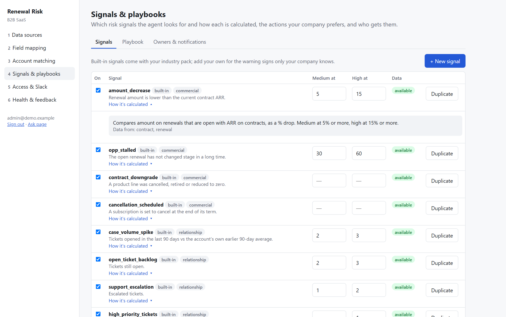
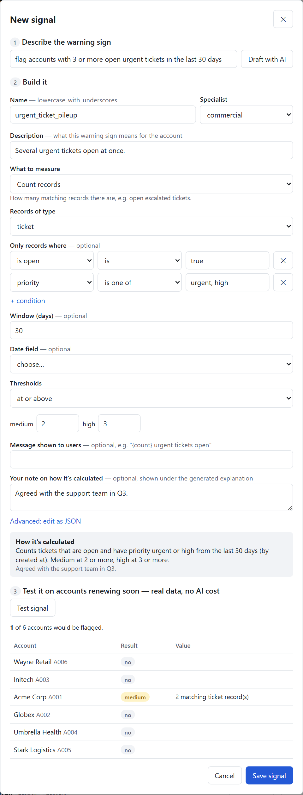
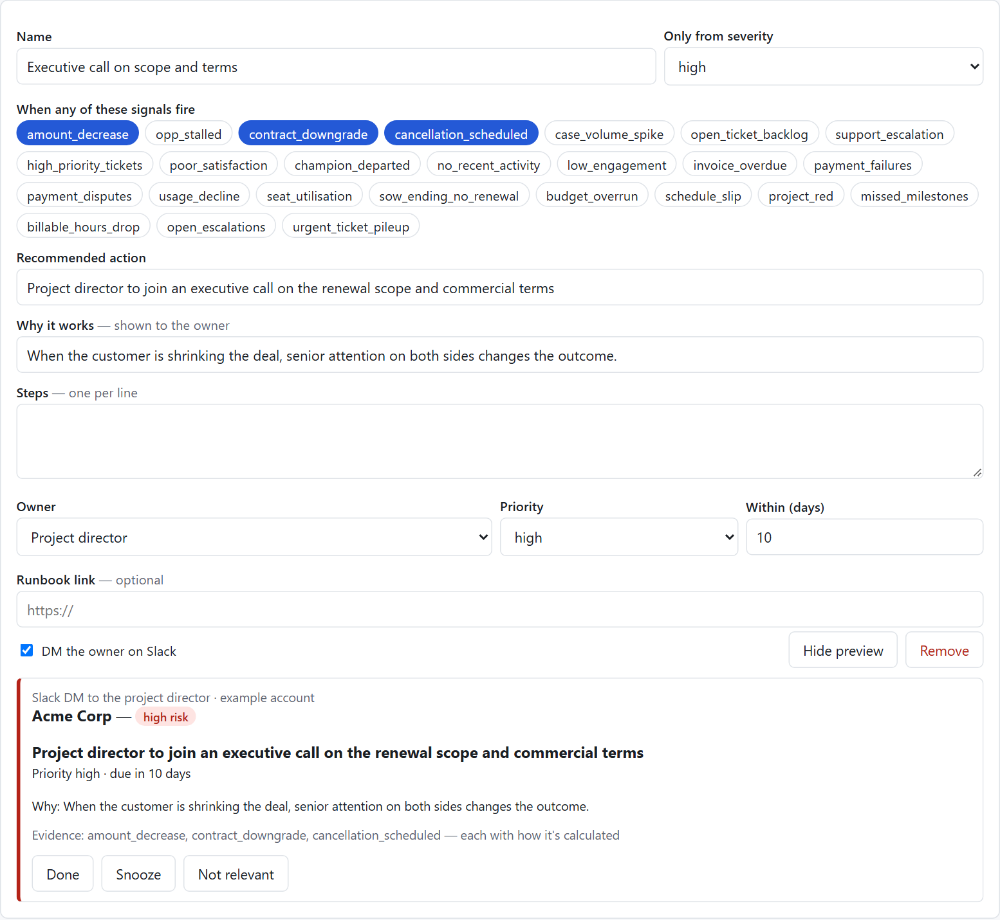
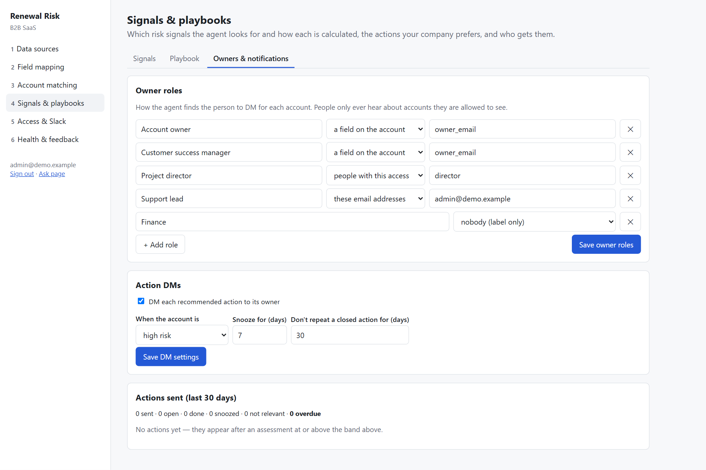

# Admin guide

For the person who installs and configures the agent. Everything is set up in
the **admin UI** (`/admin/`) or in config files — never in code. Both write the
same files, so you can start in the UI and keep the result in Git. The config
directory is `./config` by default; you can override it with `--config DIR` or
`RENEWAL_RISK_CONFIG_DIR`.

## 0. The admin UI

Run `renewal-risk serve` (or the Docker image) and open `http://<host>:8080/admin/`.

| Step | Screen | What you do |
|---|---|---|
| First run | Setup | Enter the one-time **setup token** printed in the server log, create the admin account, and choose the **business type**: B2B SaaS or IT services & consulting. |
| 1 | Data sources | The screen shows one card per data category for your business type. For each card, pick a system from the dropdown and sign in. **OAuth** systems open their own sign-in page. **Token** systems take a key. **CSV / Excel upload** works for anything else. If a system holds other kinds of data too (e.g. Salesforce support cases), the dialog asks whether to use it for those as well. **Test** checks the connection. |
| 2 | Field mapping | **Suggest with AI** proposes, for every standard field, which field in your system holds it (see section 2). Change anything with the field picker or an expression, click **Preview** to see how the records will look to the agent, then **Save**. |
| 3 | Account matching | Shows the share of accounts each system matched. Choose the match rules, then click **Match** or **Not a match** on each suggested match. |
| 4 | Signals & playbooks | Switch signals on or off, set thresholds, and write your approved actions. |
| 5 | Access & Slack | Add people (by their Slack email) with a role and scope, create API keys, paste the Slack tokens, and send a test message. |
| 6 | Health & feedback | Shows what is still missing, connection status, cost, and recent assessments. Mark each assessment agree/disagree and record the real renewal outcome; these feed the evaluation. |

**Where credentials go:** secrets typed into the UI are stored encrypted in
`<state dir>/secrets.sqlite`. The config files only hold references such as
`${SECRET:sources/billing/api_key}`. OAuth tokens are refreshed automatically.

**OAuth uses your own app, at no cost:** create an OAuth app in the system (a
Salesforce External Client App, a HubSpot developer app, a Zendesk OAuth
client), register the callback URL the UI shows
(`<RENEWAL_RISK_PUBLIC_URL>/admin/oauth/callback`), and paste its client id and
secret. A hosted edition can later ship its own registered apps for true
one-click sign-in; the flow stays the same.

## Config files

| File | Purpose | Required |
|---|---|---|
| `connectors.yaml` | which systems the data comes from, and how they link | yes |
| `mappings/<source>.overrides.yaml` | field differences from a preset | no |
| `access.yaml` | who sees which accounts | yes, for Slack and the API |
| `slack.yaml` | Slack app and alert routing | for Slack |
| `agent.yaml` | models, policy, schedule, limits (merged over [defaults](../renewal_risk/defaults/agent.yaml)) | no |
| `signals.yaml` | signal thresholds (merged over [defaults](../renewal_risk/defaults/signals.yaml) by name) | no |
| `playbooks.yaml` | your approved actions per signal | no |
| `links.csv` | approved and rejected account matches (written by `link --review`) | no |
| `presets/*.yaml` | your own presets, which extend the catalog | no |

Secrets never go in YAML. Write `${ENV:NAME}` / `${ENV:NAME:-default}` and put
the value in `.env` or in the container's environment, or enter it in the admin
UI, which stores it encrypted and writes `${SECRET:<key>}`.

**Business type:** `agent.yaml` `pack: saas` or `pack: it_services`
([packs](../renewal_risk/packs)). The pack sets the setup categories, the
specialists, which signals are on by default, the default playbook, and the
wording used in the UI and Slack ("SOW renewal" vs "renewal").

---

## 1. Connect systems

### With a preset

Run `renewal-risk presets` to see the catalog. With a preset, you only fill in
its parameters:

```yaml
primary: crm                     # the source that owns the account list (and usually renewals)
sources:
  crm:     {preset: salesforce, org_alias: prodOrg}
  billing: {preset: stripe, api_key: "${ENV:STRIPE_API_KEY}"}
  support: {preset: zendesk, subdomain: acme, email: ops@acme.com, api_token: "${ENV:ZENDESK_API_TOKEN}"}
```

| Preset | Provides | Credentials |
|---|---|---|
| `salesforce` | account, renewal (Opportunity), contract, line_item (Asset), contact (contact roles), activity (Task+Event), ticket (Case) | **OAuth** (your External Client App; REST API) or an `sf` CLI org alias (official Salesforce MCP server) |
| `hubspot` | account/customer (companies), renewal (deals), ticket, contact, activity (meetings) | **OAuth** (your developer app) or a private app token |
| `stripe` | customer, contract (subscriptions), line_item, invoice, payment (charges) | restricted read-only key |
| `zendesk` | customer (organizations), ticket | **OAuth** (your OAuth client) or agent email + API token |
| `freshdesk` | customer (companies), ticket | API key |
| `jira` | customer + project (Jira projects), milestone (releases), escalation (labelled / Highest issues) | email + API token |

A preset can offer several `auth_methods`. A config picks one with
`auth: {method: oauth2}`; otherwise the first method whose required settings are
present is used.

For your own preset, put a YAML file in `config/presets/`. It uses the same
format as [the built-in ones](../renewal_risk/presets). Use `{{param}}` placeholders
and declare them under `params:`.

### With a generic connector

These connect systems that have no preset:

| `type:` | For | What each entity block contains |
|---|---|---|
| `rest` | any JSON API | `request: {method, path, params, json, records_path, pagination}` |
| `sql` | Postgres, MySQL, SQL Server, Snowflake, BigQuery, SQLite… | `query:` using bind parameters `:link_value`, `:as_of` |
| `csv` | exports, systems with no API | `file:`, plus `match:` (the account column) for fetch |
| `mcp` | anything with an MCP server (ERPs, internal data services) | `tool:`, `args:`, `records_path:` |

Each entity block has up to three requests plus a field mapping:

```yaml
ticket:
  fetch:  {...}      # records for ONE account; templates: {link_value} {as_of} {as_of_epoch} {as_of_iso}
  list:   {...}      # all records (needed for account, customer, and renewal-window listing)
  search: {...}      # optional account search; template {text}
  fields: {...}      # standard field -> expression
```

Complete examples are in [`examples/`](../examples). The read-only rules are
built in:

* **SQL:** a single SELECT or WITH statement, values passed as bind parameters,
  inside a transaction that is rolled back.
* **REST:** GET and POST only. POST exists for search endpoints.
* **MCP:** the connector only calls tools that are named in the config.
* **Salesforce:** SELECT only, with an as-of filter added to every query.

### The standard data model

Signals, prompts and Slack only use these entities and fields
([source](../renewal_risk/core/model.py)):

| Entity | Key fields |
|---|---|
| account | id, name, domain, owner_email, region, segment, portfolio, arr, `key_*` (foreign ids) |
| customer | id, name, domain, `key_*`. A non-primary source's own customer object, used only for linking. |
| renewal | account_id, account_name, amount, prior_amount, close_date, stage, is_open, stage_changed_at |
| contract | arr, status, start_date, end_date, term_months, cancel_scheduled |
| line_item | product, quantity, prior_quantity, status, is_active |
| contact | name, title, role, is_primary, is_active |
| activity | type, activity_date |
| ticket | status, is_open, priority, is_escalated, satisfaction (1-5), opened_at, closed_at |
| invoice | amount, amount_due, status, is_paid, due_date, paid_at |
| payment | amount, status, is_failed, is_disputed |
| usage_metric | metric, period_start, value |
| project *(IT services)* | name, status, rag, rag_changed_at, budget, budget_consumed, start_date, planned_end, forecast_end, is_active |
| milestone | project_id, name, status, due_date, completed_at, is_completed |
| time_entry | project_id, hours, is_billable, work_date |
| change_request | project_id, status, amount |
| escalation | severity, status, is_open, opened_at, closed_at |

Every field has a description and common aliases
([model.py](../renewal_risk/core/model.py)). The UI shows them, and the mapping
agent maps onto them.

Every entity also has `id`, `created_at` and `updated_at`. A field that is not
in this table is dropped when records are read. **There is no free-text field
at all.** Descriptions, comments and ticket bodies cannot reach the model.

## 2. Map fields (only where you differ)

Presets already map their fields. If your system uses a custom field, override
just that one:

```yaml
# config/mappings/crm.overrides.yaml
contract:
  fields:
    arr: ARR__c
account:
  fields:
    region: Sales_Region__c
contact:
  fields:
    is_active: "Contact.Title | startswith('(Former)') | not"
```

**The AI mapping agent** (the **Suggest with AI** button, or
`renewal-risk mapping suggest --source crm --entity contract`) works in four steps:

1. It reads each source field's metadata: name, label, the description your
   admins wrote, type and allowed values. This comes from Salesforce
   `FieldDefinition` and describe, HubSpot properties, Zendesk ticket fields, or
   Jira fields. It also samples up to 20 records for example values. Free-text
   fields are listed but never sampled or sent to the model.
2. It ranks candidate fields for each standard field by name, alias,
   description and type, without calling the model.
3. It asks Claude once per entity to choose fields, write expressions and value
   maps (e.g. `P1 → urgent`), and give each choice a confidence and a reason.
   Fields already mapped by a preset are kept unless the model has a better
   answer. Without an API key, step 3 is skipped and the rule-based guess is used.
4. It validates every expression and reports what is still needed: unmapped
   required fields, and signals left without data.

Suggestions at 85% confidence or above, with no warnings, are marked for
automatic acceptance. Everything else is for you to review. The model is only
used at setup: assessments use the saved mapping, which is fixed, versioned and
reviewable.

**Expression syntax:** a dotted path (`items.data[0].quantity`), optionally piped
through filters. Available filters are `lower upper int num bool not date cents
domain first len sum empty present default(x) coalesce(path) eq(x) ne(x) in(a,b)
not_in(a,b) startswith(x) contains(x) multiply(x) divide(x)`. A dict form maps
values, for example `{expr: priority, map: {1: low, 4: urgent}}`. A quoted
string such as `"'meeting'"` is a constant.

## 3. Link accounts across systems

The primary source owns the account list. Each other source says how its
customers match those accounts. Rules are tried in order, and the first match
wins:

```yaml
linking:
  billing:
    - match: "key_account_id = account.id"   # the customer stores the CRM id (Stripe metadata, Zendesk external_id)
    - match: "id = account.key_stripe_id"     # ...or the CRM stores the billing id
    - match: domain                          # email / website domain (free mail domains ignored)
    - match: fuzzy_name                      # similar names -> REVIEW QUEUE, never automatic
      threshold: 0.88
  usage:
    - match: same_id                         # the source already uses the CRM account id
```

* `renewal-risk link --preview` shows, for each source, the share of accounts
  linked, the matches waiting for review, and the customers left unmatched.
* `renewal-risk link --review` takes you through each suggested match (y/n) and
  saves your decisions to `config/links.csv`. You can also edit that file by
  hand. `approved` rows always win, and `rejected` rows are never used.
* One account can link to several customers, for example two Stripe customers.
* An unlinked account is still assessed from the sources that do have its data.
  Its brief names the missing source, so nothing is silently guessed.

The links are cached in `state/links.json` and refreshed every
`linking.cache_hours`, or as soon as `links.csv` changes.

## 4. Grant access (`access.yaml`)

```yaml
users:
  - {email: revops@acme.com, role: admin}
  - {email: pd.emea@acme.com, role: director, scope: {region: [EMEA]}}
  - {email: vp.cs@acme.com,   role: director, scope: all}
  - {email: csm1@acme.com,    role: csm}                      # no scope = only accounts they own
domains:
  - {domain: acme.com, role: viewer, scope: {owner_email: self}}   # everyone else on the domain
api_keys:
  - {name: bi-dashboard, key: "${ENV:RISK_API_KEY_BI}", as: revops@acme.com}
```

| Role | view | bulk (window questions) | assess (start a paid run) | admin |
|---|---|---|---|---|
| admin (all accounts) | ✓ | ✓ | ✓ | ✓ |
| director, manager | ✓ | ✓ | ✓ | |
| csm | ✓ | | ✓ | |
| viewer | ✓ (stored assessments only) | | | |

* **Scope keys** are standard account fields. A list means any of the values,
  `self` means the user's own email, and `all` means everything. A role can be
  redefined under `roles:`.
* **Users not in the file get nothing.** Slack identifies people by their
  profile email.
* **Out-of-scope accounts look the same as missing ones.** The user is told "no
  account you have access to matches", so the agent never confirms that an
  account exists.

## 5. Slack

1. Go to api.slack.com/apps, choose **Create New App**, then **From a manifest**,
   and paste [`slack_manifest.yaml`](../slack_manifest.yaml).
2. Install the app. Copy the bot token (`xoxb-`) into `SLACK_BOT_TOKEN`. Create an
   app-level token with `connections:write` (`xapp-`) and put it in `SLACK_APP_TOKEN`.
3. Fill in `config/slack.yaml`:

```yaml
mode: socket                     # outbound websocket: no public URL needed
bot_token: ${ENV:SLACK_BOT_TOKEN}
app_token: ${ENV:SLACK_APP_TOKEN}
command: /renewal-risk
reply_visibility: ephemeral      # slash-command answers visible only to the asker
alerts:
  channel: "#renewal-risk"
  dm_owner: true                 # DM the account owner (if access.yaml lets them see it)
  dm_roles: [director]           # DM directors whose scope covers the account
  min_band: high
actions:                         # recommended actions DM'd to their owners (section 6)
  dm_owners: true
  min_band: high                 # only for accounts at this band or above
  snooze_days: 7                 # what the Snooze button means
  cooldown_days: 30              # a closed action is not re-sent for this long
```

Users can then:

* run `/renewal-risk Acme`, `/renewal-risk at risk this quarter` or
  `/renewal-risk high risk renewals next 90 days`;
* write `@Renewal Risk why is Globex high risk?` in a channel (the answer goes in
  a thread), or send the bot a DM;
* press the buttons on an answer: **View evidence** opens every signal with its
  cited record, and **Re-run now** runs a fresh assessment.

A single-account answer shows the risk band, the score, why, the top drivers,
the recommended actions, and which systems the evidence came from.

Window answers screen every renewal in the window for free, then fully assess
the riskiest few. `bulk.max_deep_assessments` caps the spend per question. An
assessment stored within the last `reuse_assessment_hours` is reused.

## 6. Signals, playbooks, schedule

Everything in this section can be done on the **Signals & playbooks** screen,
which has three tabs: **Signals**, **Playbook** and **Owners & notifications**.

### Signals

**Signals** ([defaults](../renewal_risk/defaults/signals.yaml)) cover
commercial, relationship, financial and usage risk. Every signal, built-in or
custom, has a **How it's calculated** sentence that the agent generates from
its definition, for example:

> Counts tickets that are open. Medium at 2 or more, high at 3 or more.

The same sentence appears on the admin screen, under each signal in Slack's
**View evidence** dialog, in action DMs, on the Ask page and in briefs. Nobody
has to guess what a number means.

**Add your own signal.** Click **+ New signal** (or **Duplicate** on a
built-in), then work through the three steps:

1. **Describe it.** Write the warning sign in plain English, for example "flag
   accounts with 3 or more open urgent tickets in the last 30 days", and press
   **Draft with AI**. The agent fills in the form, but never saves on its own.
   Without an AI key, build the signal directly in the form.
2. **Build it.** Pick what to measure (count records, days since an event,
   change vs the previous period, % difference, a ratio, days between two dates,
   "a situation is present", "something expected is missing"). Then pick which
   records and conditions, and set the thresholds. The fields offered are the
   ones your connected systems actually provide, with their descriptions.

   The **How it's calculated** box updates as you type. You can add your own
   note under it, for example "agreed with the support team in Q3".
3. **Test it.** Runs the signal on up to 20 accounts renewing soon, using real
   data and no AI cost, and lists which accounts it would flag. Then **Save**.





Custom signals are stored in `config/signals.yaml` with `custom: true`, the
author and timestamps. Every save is versioned, and saving thresholds never
drops them. In YAML:

```yaml
signals:
  - {name: no_recent_activity, thresholds: {medium: 45, high: 75}}   # tune a built-in
  - {name: poor_satisfaction, enabled: false}                        # switch one off
  - name: urgent_ticket_pileup                                       # your own
    custom: true
    specialist: relationship
    description: Several urgent tickets open at once.
    rule: count
    entity: ticket
    where: {is_open: true, priority: [urgent, high]}
    window_days: 30
    thresholds: {medium: 2, high: 3}
    how_calculated_note: Agreed with the support team in Q3.
```

The rule types are count, ratio_vs_baseline, days_since, pct_change,
window_change, ratio, exists, date_diff (e.g. forecast vs planned end) and
absent (e.g. a SOW ending with no renewal open)
([reference](../renewal_risk/core/signals.py)). Signals outside your business
type's pack start switched off; you can switch any of them on.
A signal whose data no source provides is switched off, and every brief lists
it as a gap.

### Playbook and action DMs

**Playbooks** (`config/playbooks.yaml`) list your approved responses. When the
matching signals are present, the synthesis step uses them and adapts each one
to the account. It also records which play an action came from and one
sentence on why it was recommended.

```yaml
owner_roles:                       # who owns an action, and how to find that person per account
  - {name: Account owner, find: {account_field: owner_email}}   # a field on the account
  - {name: Project director, find: {access_role: director}}     # access.yaml users whose scope covers it
  - {name: Finance, find: {emails: [ar@company.com]}}           # fixed people
  - Executive sponsor                                           # a plain name: shown, never DM'd
plays:
  - id: meet_new_decision_maker
    name: Meet the new decision-maker
    description: A departed champion is the most common silent churn cause.   # "why it works", shown to the owner
    signals: [champion_departed]
    min_severity: any                # or medium / high
    action: Meet the new decision-maker and re-run the value review
    steps: [Find who replaced the champion, Book a 30-minute value review]
    owner_role: Account owner
    priority: high
    due_in_days: 14
    link: https://wiki.company.com/playbooks/champion-loss   # your runbook
    notify: true                     # DM the owner on Slack
```

A plain role name in an older file still works. If the pack defines a role of
the same name, the role uses that pack role's `find`.

After an assessment at or above `slack.actions.min_band`, each recommended
action is **DM'd on Slack to its owner**. The DM contains the action, why it
was recommended, the steps, the due date, the runbook link and the evidence
(with how each signal is calculated). It has three buttons:

* **Done**
* **Snooze** (for `snooze_days`)
* **Not relevant**

Safety rules:

* A person is only DM'd about accounts that `access.yaml` lets them see.
* An action that is still open or snoozed, or was closed in the last
  `cooldown_days`, is not sent again.
* Only the owner or an admin can press the buttons. Each click is also recorded
  as feedback for the evaluation.





**Owners & notifications** shows the DM settings and every action sent, with
its status. **Health** shows how many actions are open, done and overdue, and
the completion rate.

**Schedule** (`agent.yaml`):

```yaml
schedule:
  enabled: true
  cron: "0 6 * * 1-5"
  lookahead_days: 120
  deep_assess: flagged
  max_deep_assessments: 25
```

When enabled, `serve` runs the scan in-process. You can also run
`renewal-risk scan` from cron or Kubernetes instead. An alert fires once, when
an account rises into `min_band`. It can fire again only after the account has
dropped below that band and risen back.

## 7. Check everything

```bash
renewal-risk validate-config          # static: schemas, mappings, linking rules, signals, env vars
renewal-risk test-connector [SOURCE]  # live connection per source
renewal-risk setup check --account ID # all of the above + link coverage + active signals + a free sample screen
renewal-risk ask "Acme" --as pd.emea@acme.com   # what a given person would see
```

## 8. Deployment

* **Docker:** `docker compose up` builds the admin UI, mounts `./config`
  (writable, because the UI saves there), and keeps state in a volume. The setup
  token is in `docker compose logs`. Salesforce over OAuth needs nothing else.
  To use the sf CLI method instead, build with `--build-arg INSTALL_SF_CLI=true`
  and authorise inside the container with `sf org login jwt`.
* **Plain Python:** `pip install ".[all]"`, `cd web && npm install && npm run build`,
  then `renewal-risk serve --host 0.0.0.0`.
* **`RENEWAL_RISK_PUBLIC_URL`:** the URL people use to reach the service, e.g.
  `https://risk.acme.com`. OAuth callback URLs are built from it, and session
  cookies are marked `Secure` when it is https. Put the service behind TLS for
  anything beyond a laptop.
* **`RENEWAL_RISK_MASTER_KEY`:** the encryption key for stored credentials (a
  Fernet key: `python -c "from cryptography.fernet import Fernet; print(Fernet.generate_key().decode())"`).
  Without it, a key file is generated in the state directory. In production, set
  it from your secret manager and back it up: losing it means re-entering every
  credential.
* **State:** `RENEWAL_RISK_STATE_DIR` holds the SQLite store (assessments,
  feedback, admin users, config and mapping history), the encrypted secret store
  and the link cache. Back it up.
* **Data policy:** customer fields (no free text) are sent to the Anthropic API.
  Set `policy.zdr_confirmed: true` only after a Zero Data Retention agreement (or
  equivalent) covers your Anthropic organization. Until then, full assessments
  are refused for sources that are not marked `test_data: true`. The free screen
  and linking still work.
* **The Salesforce MCP server** shows its own usage-telemetry notice when it
  starts. That telemetry is separate from Anthropic. Review it at
  github.com/salesforcecli/mcp before connecting a production org.
* **Cost:** recorded on every assessment (`cost_usd`), using the rates in
  `agent.yaml` `llm.rates`. Check those rates against current pricing.
